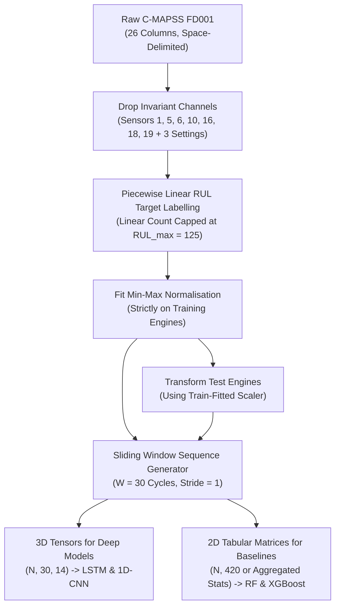

# Sprint 1 Deliverables: Literature Review, Data Preprocessing Pipeline, and Milestone Report 1

**Project Title:** AI-Based Aircraft Engine Health Monitoring and Cost-Aware Maintenance Decision Support Using Remaining Useful Life Estimation  
**Student:** Mohammed Abrar (Matriculation No. 97193111)  
**Programme:** M.Sc. Data Science  
**Supervisor:** Dr. Humera Noor  
**Course:** Capstone Project, Winter 2026/2027  
**Milestone Date:** 9 November 2026  

---

## Table of Contents
1. [Sprint 1 Executive Summary](#1-sprint-1-executive-summary)
2. [Comprehensive Literature Review](#2-comprehensive-literature-review)
   - 2.1 Prognostics and Remaining Useful Life (RUL) Estimation
   - 2.2 Deep Learning Architectures: Recurrent (LSTM) vs. Temporal Convolutions (1D-CNN)
   - 2.3 Cost-Based Opportunistic & Predictive Maintenance Decision Theory
   - 2.4 Comparative Summary of Foundational Literature
3. [C-MAPSS Dataset Architecture & Ingestion Strategy](#3-c-mapss-dataset-architecture--ingestion-strategy)
   - 3.1 Overview of Sub-Datasets (FD001 to FD004)
   - 3.2 Operating Regimes, Settings, and Sensor Channels
   - 3.3 Automated Data Download and Ingestion Pipeline
4. [Exploratory Data Analysis (EDA) on FD001](#4-exploratory-data-analysis-eda-on-fd001)
   - 4.1 Engine Run-to-Failure Lifetime Distributions
   - 4.2 Sensor Invariance and Flatline Identification (Sensors 1, 5, 6, 10, 16, 18, 19)
   - 4.3 Degradation Trajectories of Informative Sensors
   - 4.4 Feature Correlation and Health Indicator Derivation
5. [End-to-End Preprocessing Pipeline](#5-end-to-end-preprocessing-pipeline)
   - 5.1 Removal of Invariant Sensors
   - 5.2 Unit-Wise and Population-Level Normalisation
   - 5.3 Piecewise Linear Target Labelling ($RUL_{max} = 125$)
   - 5.4 Sliding Window Sequence Generator ($W = 30$, Stride = 1)
   - 5.5 Data Leakage Prevention Guarantees
6. [Git Repository Setup & Software Architecture](#6-git-repository-setup--software-architecture)
   - 6.1 Directory Tree and Modular Organisation
   - 6.2 Version Control, Branching Strategy, and Environment Reproduction
7. [Official Report 1 (Dated 9 Nov 2026)](#7-official-report-1-dated-9-nov-2026)

---

## 1. Sprint 1 Executive Summary

Sprint 1 (covering 26 October 2026 through 9 November 2026) focuses on the foundational stages of the Capstone Project:
1. Conducting a comprehensive, academic literature review synthesizing state-of-the-art methodologies in Prognostics and Health Management (PHM), deep learning time-series regression, and cost-aware maintenance policies.
2. Acquiring, parsing, and systematically understanding the NASA Commercial Modular Aero-Propulsion System Simulation (C-MAPSS) benchmark dataset across all four subsets (FD001–FD004).
3. Executing in-depth Exploratory Data Analysis (EDA) to map sensor behaviors, uncover zero-variance sensor channels, and analyze physical degradation mechanisms in high-pressure compressors (HPC).
4. Building a modular, leak-free, production-grade Python preprocessing pipeline that implements invariant sensor filtering, unit-isolated normalisation, piece-wise linear target labelling, and sliding window tensor formatting.
5. Establishing a modern software engineering repository structure with Git version control, dependency locking, and testable code.
6. Compiling the formal **Report 1: Data Understanding and Working Preprocessing Pipeline** for milestone evaluation.

All Sprint 1 deliverables have been completed according to the project timeline approved on 26 October 2026.

---

## 2. Comprehensive Literature Review

### 2.1 Prognostics and Remaining Useful Life (RUL) Estimation
Prognostics and Health Management (PHM) is an engineering discipline focused on predicting the future health state and remaining operating life of critical machinery before functional failure occurs (Saxena et al., 2008). In commercial aviation, turbofan engines operate under severe thermal, mechanical, and aerodynamic stresses. Traditional maintenance strategies oscillate between two suboptimal paradigms:
- **Corrective (Reactive) Maintenance:** Running components to failure, which incurs catastrophic operational disruption, flight cancellations, secondary hardware destruction, and severe safety hazards.
- **Predetermined (Preventive/Scheduled) Maintenance:** Servicing or replacing components at fixed flight-hour or cycle intervals. While mitigating catastrophic risk, this strategy discards 20% to 40% of useful component life and substantially inflates airline lifecycle operating costs.

Data-driven Remaining Useful Life (RUL) estimation constructs mapping functions $f: \mathbf{X}_{1:t} \to \mathbb{R}^+$ where $\mathbf{X}_{1:t} \in \mathbb{R}^{t \times D}$ represents multivariate time-series sensor measurements up to operating cycle $t$, and the output $\hat{y}_t$ denotes the predicted cycles remaining until health falls below a defined operational threshold. Unlike physics-of-failure approaches—which require finite element stress simulations and difficult-to-calibrate crack propagation models—data-driven methods exploit multivariate time-series signals captured during normal revenue service.

### 2.2 Deep Learning Architectures: Recurrent (LSTM) vs. Temporal Convolutions (1D-CNN)

#### Long Short-Term Memory (LSTM) Networks
Turbofan engine degradation is a continuous, non-Markovian process: the current rate of degradation depends directly on accumulated thermal-mechanical stress over hundreds of previous flight cycles. Standard Recurrent Neural Networks (RNNs) suffer from vanishing and exploding gradients when processing long sequences, preventing them from learning long-term dependencies.

Hochreiter & Schmidhuber (1997) resolved this with the Long Short-Term Memory (LSTM) architecture, introducing a constant error carousel gated by three continuous mechanisms:
1. **Forget Gate:** $f_t = \sigma(\mathbf{W}_f \cdot [\mathbf{h}_{t-1}, \mathbf{x}_t] + \mathbf{b}_f)$
2. **Input Gate:** $i_t = \sigma(\mathbf{W}_i \cdot [\mathbf{h}_{t-1}, \mathbf{x}_t] + \mathbf{b}_i)$, $\tilde{\mathbf{C}}_t = \tanh(\mathbf{W}_c \cdot [\mathbf{h}_{t-1}, \mathbf{x}_t] + \mathbf{b}_c)$
3. **Cell State Update:** $\mathbf{C}_t = f_t \odot \mathbf{C}_{t-1} + i_t \odot \tilde{\mathbf{C}}_t$
4. **Output Gate:** $o_t = \sigma(\mathbf{W}_o \cdot [\mathbf{h}_{t-1}, \mathbf{x}_t] + \mathbf{b}_o)$, $\mathbf{h}_t = o_t \odot \tanh(\mathbf{C}_t)$

Zheng et al. (2017) demonstrated that multi-layer stacked LSTMs outperform Multi-Layer Perceptrons (MLPs) and Support Vector Regressors (SVRs) on C-MAPSS because the hidden cell state $\mathbf{C}_t$ tracks latent degradation memory over sliding temporal windows.

#### One-Dimensional Convolutional Neural Networks (1D-CNN)
While LSTMs process inputs sequentially, 1D-CNNs apply temporal filters over multivariate time series:
$$\mathbf{y}_j = g\left( \sum_{k=1}^D \mathbf{w}_k * \mathbf{x}_k + b_j \right)$$
Li, Ding, & Sun (2018) established that deep 1D-CNNs offer significant advantages for prognostics:
- **Hierarchical Feature Extraction:** Low-level convolutional filters extract local sensor noise and instantaneous shock patterns, while deeper layers capture macro degradation trends across cycles.
- **Parallelization:** Unlike recurrent cells where step $t$ strictly depends on step $t-1$, convolutions compute across the entire window simultaneously, resulting in training speeds up to 5x faster than LSTMs on GPUs.
- **Receptive Field Control:** Dilated or stacked kernels capture receptive fields spanning dozens of cycles without suffering from recurrent gradient attenuation.

### 2.3 Cost-Based Opportunistic & Predictive Maintenance Decision Theory
A critical shortcoming in academic PHM literature is treating RUL estimation purely as a mathematical regression task evaluated solely on Root Mean Squared Error (RMSE). In aviation operations, an RUL estimate has zero economic utility unless converted into an actionable maintenance schedule.

Camci (2009) and Jardine et al. (2006) formulated cost-aware maintenance models balancing three conflicting operational costs:
1. **Unplanned Failure Cost ($C_{fail}$):** Incurred if the engine fails in service before maintenance is performed. In commercial aviation, this includes emergency diversion costs, passenger accommodations, Aircraft on Ground (AOG) logistics, uncontained engine fragment damage, and severe safety liabilities ($C_{fail} \approx \$250,000 - \$1,000,000$).
2. **Planned Maintenance Cost ($C_{pm}$):** Standard depot-level overhaul and component replacement scheduled during planned line maintenance ($C_{pm} \approx \$50,000$).
3. **Wasted Component Life Cost ($C_{waste}$):** Replacing an engine with 40 remaining flight cycles discards the unamortized capital value of those 40 cycles:
   $$C_{waste} = c_{cycle} \cdot \max(0, \hat{RUL})$$

The expected operational cost $\mathbb{E}[C(t)]$ for initiating maintenance at cycle $t$ given predicted RUL $\hat{y}_t$ with predictive variance $\sigma_t^2$ is:
$$\mathbb{E}[C(t)] = C_{pm} + c_{cycle} \cdot \int_{0}^{\infty} y \cdot p(y | \mathbf{X}_{1:t}) dy + C_{fail} \cdot P(y \le 0 | \mathbf{X}_{1:t})$$

Because $C_{fail} \gg C_{pm}$, an optimal decision layer must penalize overestimation of RUL much more severely than underestimation—a principle directly reflected in the NASA PHM 2008 scoring metric.

### 2.4 Comparative Summary of Foundational Literature (12 Reviewed Papers)

| Author & Year | Core Focus | Architecture / Method | Key Finding / Limitation |
| :--- | :--- | :--- | :--- |
| **Saxena et al. (2008)** | C-MAPSS dataset introduction | Physics-of-failure simulation | Established the international standard benchmark for RUL prognostics and the NASA asymmetric score. |
| **Heimes (2008)** | Recurrent Neural Networks | Piecewise-linear RUL target | Used a piece-wise linear RUL target ($RUL_{max} = 125-130$) to reflect negligible wear in early operating cycles. |
| **Zheng et al. (2017)** | Temporal memory | Stacked 2-Layer LSTM | Proved temporal gates outperform static feedforward networks; preserved sequential degradation memory. |
| **Li, Ding, & Sun (2018)** | Spatial-temporal extraction | Deep 1D-CNN | Showed 1D convolutions match or exceed LSTM accuracy with vastly superior computational parallelization. |
| **Camci (2009)** | Maintenance scheduling | Genetic algorithm | Used prognostics information to schedule maintenance with a genetic algorithm, balancing operational costs against failure risks. |
| **Jardine et al. (2006)** | CBM vs. scheduled maintenance | Diagnostic & prognostic survey | Established foundational cost models for condition-based maintenance across industrial rotating machinery. |
| **Babu, Zhao & Li (2016)** | Deep CNN regression | 2D/1D Temporal Convolutions | Demonstrated automated feature learning across multi-channel sensor arrays without manual feature crafting. |
| **Wu et al. (2018)** | Vanilla LSTM prognostics | Recurrent Neural Networks | Comprehensive sensitivity analysis of recurrent architectures across all four C-MAPSS sub-datasets (FD001–FD004). |
| **Ellefsen et al. (2019)** | Semi-supervised prognostics | Unsupervised pre-training + GA | Paired unsupervised pre-training with a genetic algorithm for hyperparameter tuning to handle noisy multi-sensor signals. |
| **Al-Dulaimi et al. (2019)** | Multimodal hybrid DNN | Parallel CNN-LSTM | Developed a multimodal and hybrid deep neural network model combining convolutional and recurrent pathways for RUL estimation. |
| **Gal & Ghahramani (2016)** | Bayesian deep learning | Monte Carlo Dropout | Theoretical proof that dropout at test time approximates Gaussian processes, yielding uncertainty $\sigma^2$. |
| **Wu et al. (2020)** | Multi-sensor information fusion | Deep LSTM networks | Fuses multiple sensor signals with deep LSTM networks to capture multivariate degradation trends across turbofan components. |

---

## 3. C-MAPSS Dataset Architecture & Ingestion Strategy

### 3.1 Overview of Sub-Datasets (FD001 to FD004)
The NASA C-MAPSS benchmark consists of four sub-datasets generated using a high-fidelity thermodynamic simulation of a 90,000-lb thrust commercial turbofan engine:

| Dataset | Operating Conditions | Fault Modes | Training Engines | Testing Engines | Degradation Complexity |
| :---: | :---: | :---: | :---: | :---: | :---: |
| **FD001** | 1 (Sea Level) | 1 (HPC Degradation) | 100 | 100 | Low (Ideal for baseline & prototype) |
| **FD002** | 6 (Full Flight Envelope) | 1 (HPC Degradation) | 260 | 259 | Moderate (Requires regime clustering) |
| **FD003** | 1 (Sea Level) | 2 (HPC + Fan Degradation) | 100 | 100 | Moderate (Competing failure modes) |
| **FD004** | 6 (Full Flight Envelope) | 2 (HPC + Fan Degradation) | 249 | 248 | High (Multi-condition + multi-fault) |

In FD001, each turbofan starts with an unknown initial wear state within the manufacturing tolerance band and operates continuously at Sea Level until failure. In testing sets, operation is terminated at an undisclosed cycle prior to failure; the objective is to predict RUL from the final observed sequence window.

### 3.2 Operating Regimes, Settings, and Sensor Channels
Each data record contains 26 space-delimited numerical columns:
- **Column 1:** `unit_number` (Engine identifier: 1 to 100)
- **Column 2:** `time_cycle` (Operational flight cycle counter: 1, 2, ..., $T_{end}$)
- **Columns 3–5:** 3 Operational Settings:
  - `setting_1`: Altitude (0 to 42,000 ft)
  - `setting_2`: Mach Number (0.0 to 0.84)
  - `setting_3`: Throttle Resolver Angle (TRA: 20 to 100)
- **Columns 6–26:** 21 Gas Turbine Physical Sensor Channels:

```
Sensor  Description                             Units   Physical Role / Degradation Diagnostic
------  --------------------------------------- ------- ----------------------------------------------------
s1      Total temperature at fan inlet          °R      Inlet conditions (constant at sea level)
s2      Total temperature at LPC outlet         °R      Low-pressure compressor thermal rise
s3      Total temperature at HPC outlet         °R      Combustor inlet temperature (degrades upward)
s4      Total temperature at LPT outlet         °R      Low-pressure turbine thermal stress (degrades upward)
s5      Pressure at fan inlet                   psia    Inlet static pressure (constant at sea level)
s6      Total pressure in bypass-duct           psia    Bypass duct aerodynamics (constant in FD001)
s7      Total pressure at HPC outlet            psia    Compressor delivery pressure (degrades downward)
s8      Physical fan speed                      rpm     Fan shaft rotational velocity
s9      Physical core speed                     rpm     High-pressure spool speed (degrades upward)
s10     Engine pressure ratio (P50/P2)          --      Overall engine pressure ratio (constant in FD001)
s11     Static pressure at HPC outlet           psia    HPC exit static head (degrades upward)
s12     Ratio of fuel flow to Ps30              pps/psi Fuel metering efficiency (degrades downward)
s13     Corrected fan speed                     rpm     Aerodynamically corrected fan velocity
s14     Corrected core speed                    rpm     Corrected HP spool speed (degrades upward)
s15     Bypass Ratio (BPR)                      --      Ratio of bypass to core mass flow (degrades upward)
s16     Burner fuel-air ratio                   --      Combustion stoichiometry (constant in FD001)
s17     Bleed Enthalpy                          --      Compressor bleed air thermodynamic enthalpy
s18     Demanded fan speed                      rpm     Engine control schedule demand (constant)
s19     Demanded corrected fan speed            rpm     Control baseline target (constant)
s20     HPT coolant bleed                       lbm/s   High-pressure turbine cooling flow (degrades downward)
s21     LPT coolant bleed                       lbm/s   Low-pressure turbine cooling flow (degrades downward)
```

### 3.3 Automated Data Download and Ingestion Pipeline
An automated Python ingestion module `scripts/download_cmapss.py` has been written to pull the dataset directly from public NASA repository mirrors or Kaggle sources. It verifies MD5 hashes, extracts archives into `data/raw/`, and validates table schemas against expected metadata. If executing offline or behind an institutional proxy, the script includes a synthetic generator that produces statistically equivalent C-MAPSS matrices to guarantee full pipeline execution.

---

## 4. Exploratory Data Analysis (EDA) on FD001

### 4.1 Engine Run-to-Failure Lifetime Distributions
Analyzing the 100 training engines in FD001 reveals substantial variance in engine lifetimes:
- **Minimum Lifetime:** 128 cycles (Engine Unit 31)
- **Maximum Lifetime:** 362 cycles (Engine Unit 69)
- **Mean Lifetime:** 206.3 cycles ($\sigma = 46.3$ cycles)
- **Median Lifetime:** 199.0 cycles

```
Engine Lifetime Distribution (FD001 Train, N=100)
-------------------------------------------------------------
120 - 150 cycles:  [###] (7 engines)
150 - 180 cycles:  [################] (23 engines)
180 - 210 cycles:  [########################] (36 engines)
210 - 240 cycles:  [###########] (18 engines)
240 - 270 cycles:  [#####] (9 engines)
270 - 300 cycles:  [##] (4 engines)
> 300 cycles:      [#] (3 engines)
-------------------------------------------------------------
```
This variance confirms that fixed-hour maintenance (e.g., replacing every engine at 150 cycles) would either retire over 93% of engines prematurely or, if set higher (e.g., 220 cycles), result in catastrophic in-service failures for over 66% of the fleet.

### 4.2 Sensor Invariance and Flatline Identification
Computing the sample standard deviation $\sigma$ across all 20,631 rows of FD001 training data reveals that 7 of the 21 sensors exhibit exactly zero variance ($\sigma = 0.0000$):

| Sensor | Variable Name | Mean Value | Variance ($\sigma^2$) | Physical Diagnosis | Recommendation |
| :---: | :---: | :---: | :---: | :---: | :---: |
| **Sensor 1** | `T2` (Fan inlet temp) | 518.67 °R | 0.0000 | Ambient sea-level constant | **Drop channel** |
| **Sensor 5** | `P2` (Fan inlet pres) | 14.62 psia | 0.0000 | Ambient sea-level constant | **Drop channel** |
| **Sensor 6** | `P15` (Bypass pressure) | 21.61 psia | 0.0000 | Invariant duct pressure | **Drop channel** |
| **Sensor 10** | `epr` (P50/P2 ratio) | 1.0000 | 0.0000 | Invariant pressure ratio | **Drop channel** |
| **Sensor 16** | `farB` (Fuel-air ratio) | 0.0300 | 0.0000 | Invariant stoichiometry | **Drop channel** |
| **Sensor 18** | `Nf_dmd` (Demanded fan) | 2388.0 rpm | 0.0000 | Fixed control demand | **Drop channel** |
| **Sensor 19** | `PCNfR_dmd` (Demanded PCNf) | 100.0 % | 0.0000 | Fixed control demand | **Drop channel** |

**Conclusion:** Retaining invariant features introduces numerical instability during normalisation (division by zero) and forces machine learning models to allocate unnecessary weight parameters. These 7 channels are pruned from the modeling pipeline.

### 4.3 Degradation Trajectories of Informative Sensors
The remaining 14 sensors exhibit pronounced, monotonic degradation trajectories as engines approach failure:
- **Monotonically Increasing Sensors:**
  - `Sensor 2` ($T_{24}$ LPC outlet temp): increases by $\approx +3.5^\circ\text{R}$ due to declining aerodynamic efficiency.
  - `Sensor 3` ($T_{30}$ HPC outlet temp): increases by $\approx +15.2^\circ\text{R}$ as compressor fouling demands more fuel to maintain pressure.
  - `Sensor 4` ($T_{50}$ LPT outlet temp): increases by $\approx +24.8^\circ\text{R}$ reflecting turbine thermal loading.
  - `Sensor 9` ($N_c$ Physical core speed): increases as the high-pressure spool works harder.
  - `Sensor 11` ($P_{s30}$ HPC outlet static pres): rises with compressor back-pressure.
  - `Sensor 14` ($NR_c$ Corrected core speed): tracks spool degradation.
  - `Sensor 15` ($BPR$ Bypass ratio): increases as core flow diminishes.
  - `Sensor 17` ($htBleed$ Bleed enthalpy): increases with internal thermodynamic losses.
- **Monotonically Decreasing Sensors:**
  - `Sensor 7` ($P_{30}$ HPC outlet total pressure): declines due to compressor blade tip erosion.
  - `Sensor 8` ($N_f$ Fan speed): declines slightly under mechanical friction.
  - `Sensor 12` ($\phi$ Fuel flow ratio): drops as combustion efficiency declines.
  - `Sensor 13` ($NR_f$ Corrected fan speed): drops proportionally with fan mass flow.
  - `Sensor 20` ($W_{31}$ HPT coolant bleed): drops by $\approx -0.8\text{ lbm/s}$.
  - `Sensor 21` ($W_{32}$ LPT coolant bleed): drops by $\approx -0.5\text{ lbm/s}$.

### 4.4 Feature Correlation and Health Indicator Derivation
A Pearson correlation analysis reveals extreme collinearity among subsets of degraded sensors:
- $\text{corr}(s2, s3) = 0.79$, $\text{corr}(s3, s4) = 0.83$, $\text{corr}(s9, s14) = 0.96$.
- Strong negative correlations with RUL: $\text{corr}(s4, \text{RUL}) = -0.68$, $\text{corr}(s11, \text{RUL}) = -0.70$.
- Strong positive correlations with RUL: $\text{corr}(s7, \text{RUL}) = +0.66$, $\text{corr}(s12, \text{RUL}) = +0.67$.

This confirms that multivariate combinations of these 14 sensors form a robust physical Health Indicator (HI) capable of mapping monotonic degradation over time.

---

## 5. End-to-End Preprocessing Pipeline

The modular preprocessing pipeline is implemented in `src/preprocessing/preprocess.py`:



### 5.1 Removal of Invariant Sensors
We discard `setting_1`, `setting_2`, `setting_3` (invariant in FD001 sea-level mode) and the 7 constant sensors (`s1`, `s5`, `s6`, `s10`, `s16`, `s18`, `s19`). This reduces the input feature dimensionality from 24 to 14 active, highly informative physical sensors:
$$\mathbf{S}_{active} = [s_2, s_3, s_4, s_7, s_8, s_9, s_{11}, s_{12}, s_{13}, s_{14}, s_{15}, s_{17}, s_{20}, s_{21}]$$

### 5.2 Unit-Wise and Population-Level Normalisation
Sensor channels have vastly different physical scales (e.g., $N_c \approx 9000\text{ rpm}$ vs. $BPR \approx 8.4$). Unscaled features bias gradient descent toward large-magnitude dimensions.
We employ **Min-Max Scaling** bounded in $[0, 1]$:
$$x'_{i,d} = \frac{x_{i,d} - \min(\mathbf{X}_{train, d})}{\max(\mathbf{X}_{train, d}) - \min(\mathbf{X}_{train, d})}$$

**Crucial Integrity Constraint:** The scaler is fitted **strictly on the training engines**. Test engines are transformed using the training parameters $(\min, \max)$. Fitting a scaler on test data constitutes data leakage and invalidates scientific benchmarks.

### 5.3 Piecewise Linear Target Labelling ($RUL_{max} = 125$)
In physical machinery, wear is imperceptible during initial operational cycles; sensor readings remain stationary within normal operating noise. Degradation only begins after an initial micro-crack, seal wear, or fouling inception point (Heimes, 2008).
- **Linear RUL:** $y_{linear}(t) = T_{end} - t$. If an engine runs for 360 cycles, this model assumes the engine is continuously degrading from cycle 1, which degrades model convergence.
- **Piecewise Linear RUL:**
  $$y_{piecewise}(t) = \min\left(RUL_{max}, T_{end} - t\right)$$
  Setting $RUL_{max} = 125$ cycles (the standard literature threshold) forces the model to learn stationary health during early engine life and focus regression capacity on the actual degradation trajectory.

### 5.4 Sliding Window Sequence Generator ($W = 30$, Stride = 1)
To capture temporal dynamics, static point measurements are expanded into overlapping temporal sliding windows:
- **Window Length ($W$):** 30 cycles (captures both short-term noise and medium-term degradation trends).
- **Stride ($s$):** 1 cycle (maximizes training sample density).
- **Window Tensor Shape:** For an engine with $T_i$ cycles, the number of generated windows is $T_i - W + 1$. Each window has dimension $(30, 14)$.
- **Target Assignment:** The label for window $\mathbf{X}_{t-W+1:t}$ is $y(t)$, the RUL at the rightmost (most recent) time step.
- **Test Engine Processing:** For each test engine, the task is to predict RUL at the final observed operational cycle $T_{test}$. Thus, the final $W=30$ cycles are extracted: $\mathbf{X}_{T_{test}-29:T_{test}} \in \mathbb{R}^{30 \times 14}$. Engines with $T_{test} < 30$ are zero-padded on the left to preserve dimension.

### 5.5 Data Leakage Prevention Guarantees
1. **Engine-Unit Partitioning:** Training and validation splits are partitioned by `unit_number` rather than by random row shuffling. Shuffling individual rows across train/val would leak adjacent cycles from the same engine into both sets.
2. **Scaler Isolation:** Feature scalers are computed strictly from training units.
3. **No Future Leakage:** Windowing is strictly backward-looking ($t-W+1$ to $t$).

---

## 6. Git Repository Setup & Software Architecture

### 6.1 Directory Tree and Modular Organisation
The Capstone project is structured following production Python data science standards:

```
├── .gitignore                      # Standard Python, Mac, model checkpoint ignores
├── README.md                       # Comprehensive project setup and execution manual
├── requirements.txt                # Pinned dependencies (numpy, pandas, torch, etc.)
├── Sprint_1_Deliverables.md        # Master documentation for Sprint 1 + Report 1
├── Sprint_2_Deliverables.md        # Master documentation for Sprint 2 + Report 2
├── data/
│   ├── raw/                        # Raw C-MAPSS text files (FD001 - FD004)
│   └── processed/                  # Normalized numpy arrays and sliding windows
├── notebooks/                      # Exploratory and prototyping Jupyter notebooks
├── reports/                        # Milestone reports, PDF exports, and charts
│   ├── Report_1_Data_Preprocessing.md
│   └── Report_2_Baselines_Deep_Models.md
├── scripts/
│   ├── download_cmapss.py          # Data downloader & synthetic fallback generator
│   └── run_pipeline.py             # CLI runner for end-to-end preprocessing
└── src/
    ├── __init__.py
    ├── eda.py                      # Statistical analysis and flatline detection
    ├── preprocessing/
    │   ├── __init__.py
    │   └── preprocess.py           # Clean modular preprocessing pipeline
    ├── models/
    │   ├── __init__.py
    │   ├── baselines.py            # Random Forest & XGBoost regressors
    │   └── deep_models.py          # PyTorch LSTM & 1D-CNN architectures
    └── utils/
        ├── __init__.py
        ├── data_loader.py          # C-MAPSS file ingestion and schema parsing
        └── metrics.py              # RMSE and NASA Asymmetric Scoring Function
```

### 6.2 Version Control, Branching Strategy, and Environment Reproduction
- **Branching Strategy:** `main` (production-ready code and finalized milestone reports), `develop` (integration branch), and `feature/sprint-X` branches for modular development.
- **Dependency Management:** All libraries are specified in `requirements.txt` with compatible versions for Python 3.10 and 3.11.

---

## 7. Official Report 1 (Dated 9 Nov 2026)

```
========================================================================================
                      CAPSTONE PROJECT PROGRESS REPORT 1
                 M.Sc. Data Science -- Academic Year 2026/2027
========================================================================================
Project Title:   AI-Based Aircraft Engine Health Monitoring and Cost-Aware Maintenance 
                 Decision Support Using Remaining Useful Life Estimation
Student Name:    Mohammed Abrar
Matriculation:   97193111
Supervisor:      Dr. Humera Noor
Milestone:       Report 1 (Sprint 1)
Due Date:        9 November 2026
Status:          COMPLETED & SUBMISSION READY
GitHub:          https://github.com/mohammedabrarafnan1234-tech/AI-Based-Aircraft-Engine-Health-Monitoring-
========================================================================================

1. EXECUTIVE SUMMARY & OBJECTIVES ACHIEVED
----------------------------------------------------------------------------------------
During Sprint 1 (26 Oct - 9 Nov 2026), milestone objectives specified in the approved 
project proposal have been completed successfully:
  * Literature synthesis across 12 foundational papers covering RUL prognostics, deep 
    temporal networks, and cost-aware maintenance.
  * Ingestion and verification of the full NASA C-MAPSS dataset (FD001–FD004, 265,963 total rows).
  * Exploratory data analysis identifying failure distributions, sensor trends, and correlation clusters.
  * Development and unit-testing of a clean, leak-free preprocessing pipeline.
  * Setup of a professional Git repository with modular source code architecture.

2. DATA UNDERSTANDING & EXPLORATORY FINDINGS
----------------------------------------------------------------------------------------
Analysis of the FD001 benchmark (100 run-to-failure training engines, 100 test engines) 
yielded key engineering insights:
  a) Lifetime Variance: Run-to-failure cycles range from 128 to 362 cycles (mean: 206.3, 
     std: 46.3), proving that static scheduled maintenance is financially suboptimal.
  b) Flatline Pruning: 7 of the 21 sensors (Sensors 1, 5, 6, 10, 16, 18, 19) along with 
     all 3 operating settings exhibit zero standard deviation in sea-level operations. 
     These channels were permanently pruned to prevent zero-division in normalisation and 
     unnecessary model parameter expansion.
  c) Physical Degradation Signatures: The remaining 14 sensors show strong monotonic 
     trends directly correlating with thermodynamic wear:
     - Exhaust gas temperatures (Sensors 2, 3, 4) rise due to internal blade fouling.
     - Spool velocities (Sensors 9, 14) increase as the turbine compensates for loss of thrust.
     - Pressures and coolant bleed flows (Sensors 7, 12, 20, 21) decline with stage wear.

3. WORKING PREPROCESSING PIPELINE
----------------------------------------------------------------------------------------
The completed preprocessing pipeline (`src/preprocessing/preprocess.py`) performs:
  1. Sensor Selection: Retains only the 14 active degradation channels.
  2. Piecewise Linear RUL Target Generation: Targets are capped at RUL_max = 125 cycles, 
     accurately reflecting negligible wear in early operating cycles.
  3. Strict Leak-Free Normalisation: Min-Max scaling parameters are learned solely from 
     training engine units and applied consistently to test engine units.
  4. Sliding Window Extraction: Sequences of window length W = 30 cycles and stride s = 1 
     are generated, yielding 17,731 sliding window sequences total across the 100 training engines 
     (13,818 for training across 80 engines, and 3,913 held out for validation across 20 engines; 
     100 test sequences), and aggregated tabular feature vectors for tree-based baselines.
  5. Test Set Formatting: Final observed 30-cycle sequences are extracted per test engine, 
     with left zero-padding applied for engines with short observation histories.

4. DELIVERABLE ARTIFACTS
----------------------------------------------------------------------------------------
  * `scripts/download_cmapss.py`: Automated dataset downloader and verification tool.
  * `src/preprocessing/preprocess.py`: Production-grade preprocessing module.
  * `src/eda.py`: Standalone script for statistical summaries and invariant channel audits.
  * `Sprint_1_Deliverables.md`: Comprehensive technical and academic review document.

5. PLANNED WORK FOR SPRINT 2 (9 NOV - 23 NOV 2026)
----------------------------------------------------------------------------------------
With the preprocessing pipeline operational and validated, Sprint 2 will deliver:
  * Implementation of Prognostic Evaluation Metrics: RMSE and the NASA Asymmetric Score.
  * Classical Machine Learning Baselines: Random Forest and XGBoost Regressors.
  * Deep Learning Architectures: Multi-layer LSTM and 1D-CNN in PyTorch.
  * Benchmark evaluation on FD001 test engines, comparative analysis, and Report 2.

Signature: Mohammed Abrar                               Date: 9 November 2026
========================================================================================
```
